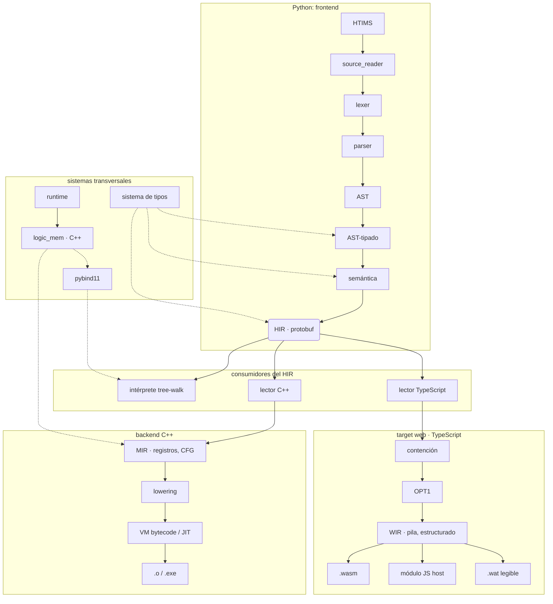

# Arquitectura de suriaX

Este documento describe el **pipeline interno** del compilador y cómo se
reparte entre los mundos del proyecto: el **frontend en Python**, el
**backend C++** y el **target web (WebAssembly)**. El objetivo educativo del
lenguaje —ver qué entrega cada etapa— hace que estas fronteras sean
explícitas.

> status: **arquitectura general definida**. El frontend, el HIR y el
> intérprete están completos; el target web ejecuta un subconjunto del
> lenguaje; el backend C++ está en construcción.

## Visión general del pipeline

## El entrypoint: `cli/` y `driver/`

El compilador se invoca hoy por línea de comandos y mañana por suriniX
(`suri run --args`), así que **pedir** y **compilar** están separados:

| Paquete | Responsabilidad |
|---------|-----------------|
| [`V0/cli/`](V0/cli/) | Qué se pide (`argparse`), cómo se muestra (hechos a stdout, diagnósticos a stderr) y con qué código termina el proceso. |
| [`V0/driver/`](V0/driver/) | El compilador **como librería**: compila y ejecuta sin terminal. `compile_source()` devuelve un `CompileResult` (métricas, artefactos, diagnósticos, tiempos) y no imprime nada; lo que quiera contar sale por un `Reporter` que pasa el llamador. |

`V0/main.py` solo prepara `sys.path` y cede el control. La frontera existe
para que suriniX reutilice el pipeline entero en vez de invocar al proceso o
reimplementarlo, y para que ejecutar sea una decisión del llamador: el driver
deja el `.phir` y dice si el target lo pide, pero no lo lanza.

## Frontend (Python)

| Fase | Entrada → Salida | Responsabilidad |
|------|------------------|-----------------|
| **HTIMS** | proyecto → `ExtensionSet` | Capa **previa al léxico**: descubre y valida las extensiones del proyecto (`extends.srcx` + `extensions:` del yaml) para que el vocabulario de hooks pueda declararlo el usuario. Vive en [htims/](htims/readme.md), fuera de `V0/`; no importa nada del frontend y nunca ejecuta el `.py` del usuario. |
| **source_reader** | bytes → `str` Unicode | Decodifica UTF-8 (una vez), normaliza saltos de línea. No tokeniza. |
| **Lexer** | `str` → `list[Token]` | Tokeniza en una pasada; salta comentarios; reconoce f-strings (`f"..."`, única forma con interpolación) y el bloque crudo `#extern cpp{}`. Termina en `EOF`. Recupera ante caracteres inválidos en vez de abortar. |
| **Parser** | `list[Token]` → AST | Descenso recursivo + Pratt para expresiones. Recuperación en modo pánico: ante un error anota y resincroniza, así un fallo no oculta los demás. |
| **AST-tipado** | AST → AST con tipos | Anota el `restype` de **toda** expresión (sistema **estático, fuerte y nominal**). |
| **Semántica** | AST-tipado → AST validado | Símbolos y scopes, visibilidad, reglas de punteros y `mutable`/`const`, move-semantics, enlace de hooks, resolución de librerías `.libsrx`. |
| **HIR (protobuf)** | AST validado → `.phir` | Representación intermedia **serializada**, frontera única hacia todos los backends. Ver [docs/hir.md](docs/hir.md) y [PROTOBUF_BRIDGE.md](V0/src/HIR/PROTOBUF_BRIDGE.md). |

El **linker de librerías** (`V0/src/linker_p/`) resuelve `#import`/`#from`
contra archivos `.libsrx` y paquetes, con caché por ruta. Cada unidad compila
a **su propio `.phir`**; el módulo principal solo las referencia.

## El sistema de tipos

No es una fase: es **transversal**. Opera sobre el AST, el AST-tipado y la
semántica, y enriquece una tabla de símbolos persistente que viaja serializada
dentro del HIR.

- **Estático y fuerte**: los tipos se resuelven en compilación y no hay
  coerciones implícitas. La **única** vía de conversión es `cast<T>(x)`:
  nativa entre primitivos, o el hook `__cast__` cuando hay un tipo nominal
  de por medio (un tipo puede declarar varias conversiones; viajan en
  `SymbolTable.casts`).
- **Nominal**: dos structs con los mismos campos son tipos distintos. La
  identidad es el nombre, no la forma.
- **Reglas de punteros en el tipo**: `ptr mutable T` (escribible a través del
  puntero) y `ptr T` (solo lectura) son tipos **distintos**; la única
  coerción segura es *soltar* mutabilidad, nunca ganarla.
- **Nullable** (`T?`) y **`error T`** (unión valor-o-error, transparente en la
  ruta de éxito: el fallo viaja por `throw`/`catch`).
- **`type` es un tipo de primera clase** (metatipo): una función puede
  devolver un tipo, y `const type int8;` declara un nominal opaco cuyo layout
  aportan sus hooks o el backend.

> **Sin terminar, a propósito.** El sistema de inferencia definitivo aún no
> está fijado (ver [ROADMAP.md](ROADMAP.md), Fase 3): se descartó
> Hindley-Milner por su complejidad, su choque con el modelo de memoria y su
> distancia del objetivo educativo. Hoy la anotación de tipos es explícita y
> la inferencia se limita a literales y expresiones.

## El puente: HIR en protobuf

La frontera hacia **todos** los backends es un HIR serializado en protobuf:

- mantiene el contexto semántico persistente (tabla de símbolos con tipos,
  mutabilidad, hooks y conversiones) a través de las IR;
- desacopla el frontend de los backends mediante `schema_version`, con
  **fail-fast**: un lector rechaza una versión que no conoce en vez de
  malinterpretarla;
- permite que cada consumidor reconstruya el contexto que necesita sin
  reimplementar el frontend.

**Alcance v1**: las construcciones de región (`region`, `new`/`delete`,
`in region`, `x at r`) nunca viajaron — se rechazaban con `HIR005` y sus tags
quedaron `reserved`. Retiradas del lenguaje en v0.2.0, los tags siguen
reservados. Move-semantics sí viaja (`MoveStmt`, `Symbol.moved_at`).

## Backend C++ (en construcción)

> El target nativo es la **VM de bytecode con JIT**, no LLVM. La generación
> de LLVM IR está fuera del plan actual: el MIR ya es un IR de registros con
> CFG, y meter LLVM en medio añadía una dependencia enorme y un segundo
> modelo de máquina antes de tener el primero funcionando. `compilerconfig`
> sigue detectando `llvm-config` y lo reporta en `--check`, pero nada de la
> compilación depende de ello.

| Fase | Entrada → Salida | Responsabilidad |
|------|------------------|-----------------|
| **Lector HIR** | `.phir` → estructuras C++ | Valida `schema_version` y reconstruye el árbol y la tabla de símbolos. |
| **MIR lowering** | HIR → **MIR** | IR de **registros** con control de flujo explícito (CFG) y las verificaciones del modelo de memoria (lifetimes de región, move). |
| **VM / JIT** | MIR → bytecode | **Target nativo estándar.** Ejecuta el bytecode y compila en caliente las rutas calientes. |
| **Targets** | bytecode → artefacto | Según `compilerconfig`: `IS_WIN32` → `.exe`, `IS_LINUX` → `.o`. |
| **Linker** | objeto(s) → ejecutable | Etapa final; `compilerconfig` aporta rutas y flags. |

## Target web (WebAssembly)

Consume el **mismo `.phir`** y baja a WebAssembly **sin pasar por LLVM**. Vive
en [`web/`](web/), en TypeScript y sin dependencias. Ver
[web/README.md](web/README.md).

| Fase | Entrada → Salida | Responsabilidad |
|------|------------------|-----------------|
| **Lector / escritor** | `.phir` ↔ `Module` | Decodificador propio del wire-format de protobuf (y su inverso, para cachear el HIR ya optimizado). Mismo fail-fast de esquema. |
| **Linker de unidades** | `.phir` + librerías → `Image` | Espejo del module linker del intérprete: índices de hooks, casts y dunders. |
| **Contención** | `Image` → diagnósticos `WEB0xx` | Qué **no puede** ejecutar el web hoy (punteros, `free`, `#extern cpp`, hooks de memoria, `move`, librerías fuera de la allowlist). Es una política declarada, no `if`s dispersos. |
| **DCE** | `Image` → `Image` | Elimina declaraciones inalcanzables, código tras un terminador, expresiones sin efectos y variables muertas. |
| **Lowering a WIR** | HIR → **WIR** | Nombres→índices, tipos nominales→`i32`/`i64`/`f64`, librería `IO`→intrínsecos del host. Lo no traducible da `WEB1xx` con posición. |
| **Emisores** | WIR → artefactos | `.wasm` (binario escrito a mano), módulo **JS host** que lo embebe y ejecuta, y `.wat` legible. |

### Por qué el WIR no es el MIR

Son **dos máquinas objetivo distintas**:

- el **MIR** es de C++ y apunta a una máquina de **registros** (la VM/JIT):
  IR de registros con grafo de control de flujo;
- el **WIR** es de WebAssembly, que es una máquina de **pila** con control de
  flujo **estructurado** (`block`/`loop`/`if` anidados, sin saltos
  arbitrarios).

En una máquina de pila el código de una expresión **es su post-orden**, así
que el WIR guarda expresiones como árbol tipado y emitir es recorrerlo: sin
registros, sin temporales. Y como WASM no admite saltos arbitrarios, un IR de
bloques básicos obligaría a reconstruir la estructura al emitir (*relooping*).
Forzar un solo IR para las dos máquinas habría dejado a las dos a medias.

## Runtime

El **runtime** es independiente del target y lo comparten los backends:

- **`runtime/logic_mem/`** — administrador de memoria lógica en **C++ puro**
  (`include/mem_core.hpp`): celdas con máquina de estados `LIVE/MOVED/FREED`,
  handles monotónicos y **códigos de estado** en vez de excepciones (no acopla
  el ABI). Es lo que enlazará la VM/JIT directamente.
- **`runtime/logic_mem/cxx_entry.cpp`** — adaptador **pybind11** (módulo
  `memory_c`): convierte objetos de Python ↔ `Value` y guarda lo no primitivo
  en un *extern store* propio, para que el core siga siendo agnóstico.
- **`runtime/cxx_api.py`** — punto de entrada único del runtime hacia
  cualquier módulo nativo: los descubre, los carga y los cachea.
- **`runtime/interpreter/`** — intérprete tree-walk que ejecuta el `.phir`:
  loader, evaluator, entornos, despacho de hooks y memoria (nativa o Python
  puro, seleccionable con `SURIAX_NATIVE_MEM`).

Punteros, `&` y move-semantics funcionan de punta a punta por este runtime.
El **drop automático** y las **arenas** se construirán encima de estas
primitivas — después de validar que los punteros son reales y manejables, no
antes.

El build del lado nativo es **único**: un `CMakeLists.txt` en la raíz y la
lógica reutilizable en [`CMake/`](CMake/), que descubre los módulos de
`runtime/*/` sin registro manual.

## Interoperabilidad C++: `#extern cpp{ ... }`

El bloque `#extern cpp{ ... }` incrusta código C++. El **lexer lo captura
crudo** (token `RAW_BLOCK`) sin tokenizarlo con las reglas de suriaX; el
contenido viaja intacto hasta el backend C++, que lo compila e integra vía los
*bindings*. La validación del C++ ocurre en el backend, no en el frontend. El
target web lo **rechaza** (`WEB001`): no hay toolchain C++ en el navegador.

## `compilerconfig` y la selección de target

`config/compilerconfig.py` es transversal a la compilación:

- detecta plataforma y dependencias (protobuf, pybind11, pyyaml, y LLVM vía
  `llvm-config` — que hoy solo se reporta: **no** está en la ruta de
  generación de código, ver el backend C++);
- lee/genera el formato de compilación `.suriaX_config.yaml`;
- expone los flags (`IS_WEB`, `IS_WIN32`, `IS_LINUX`) que el backend consulta
  para elegir el target y orquestar el linker.

## Manejo de errores

Cada fase tiene su jerarquía de errores con códigos estables (`LEXxxx`,
`PARxxx`, `ASTxxx`, `SEMxxx`, `HIRxxx`, `RTxxx`, `WEBxxx`) bajo
`V0/error_handler/`, todos derivados de `CompilerError`. Ninguna fase lanza
por construcciones del programa: **acumulan** diagnósticos con posición y los
devuelven, de modo que una compilación reporta todo lo que está mal de una
vez. `--emit-diagnostics` los expone en JSON para el editor.
