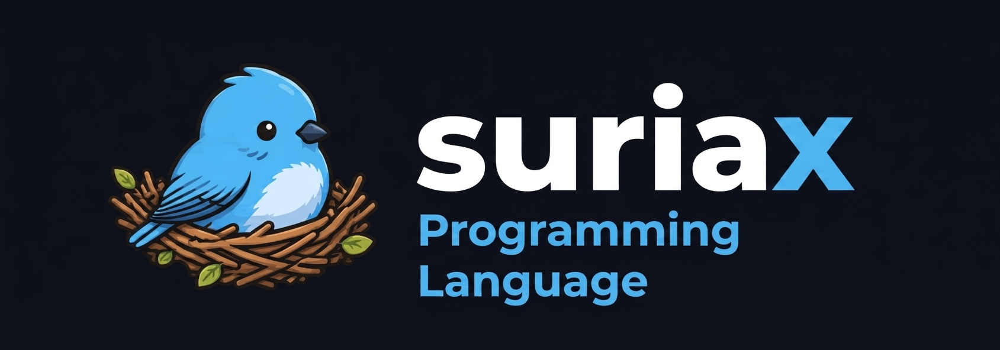

# suriaX

  <picture>
  
  </picture>
  
  
  
  
  [Español] | [website] | [getting started] | [current_errors] | [Documentation] 
  

[website]:TODO

[Español]:README_ES.md

[getting started]:https://samue1-pineda.github.io/suriaX/usage.html#tu-primer-programa

[current_errors]:c_errorstfix.md

[Documentation]:https://samue1-pineda.github.io/suriaX/
 

suriaX is a programming language whit the following goals:
- **compiler internals & visualization:** built for those students & enthusiasts who ask ¿what does every phase of the compiler give?
- **friendly syntax:** based on python and c++ suriaX always look for a easier syntax 
- **c++ interoperabilty:** by using custom Bindings suriaX let c++ run on your standar code
- **c Philosophy(libsrX):** suriaX trust on less reserved tokens & calls to libsrX
  

## project status

**ACTIVE**, working on things that already work and looking for alternatives to fix errors that already exists

**First version of the web documentation built**!

the project is currently on **V.0.1.4 (Pre-Alpha Preview)**,

[**x**] language syntax & EBNF grammar

[**x**] frontend(lexer,parser and AST generation) 

[**/**] Intermediate Representations(HIR, MIR & lowering)

[ ] Backend VM JIT

[ ] suriniX build system, web documentation & playground using LLVM -**planned**

*For the  full list of tasks, see [ROADMAP.md](ROADMAP.md).*

## architecture & internal pipeline

[architecture](ARCHITECTURE.md)

## Contributing

currently not accepting contributions 

## License

Distributed under the MIT License. See [`LICENSE`](LICENSE) for more information.
